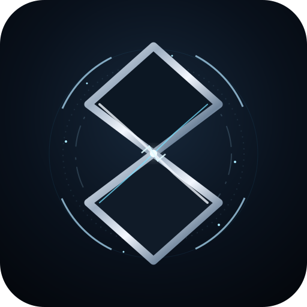

<div align="center">



# AFTERFRAME: THE LAST LOOP

### ⏳ The future is broken. The loop remembers.

*A cinematic sci-fi action RPG in active development.*

<p>
  
  
  
</p>

<p>
  <a href="#-the-premise">Premise</a> ·
  <a href="#-gameplay-pillars">Gameplay</a> ·
  <a href="#-development-status">Status</a> ·
  <a href="#-roadmap">Roadmap</a> ·
  <a href="#-project-notes">Project notes</a>
</p>

</div>

---

> [!IMPORTANT]
> **AFTERFRAME is a work in progress.** This repository documents an evolving game project, not a finished or production-ready release. Features, balance, visuals, story details, and implementation may change as development continues.

## 🌌 The premise

Reality has begun to fracture into repeating fragments. In the shadow of **Nadir-9**, every failed experiment leaves an afterimage—and every loop hides another piece of the truth.

You are **Sera Venn**, caught between a collapsing timeline and the machinery built to control it. Fight through hostile test facilities, learn how to use the technology left behind, and uncover what the loop is trying to preserve.

*The past is not gone. It is still running.*

## ⚔️ Gameplay pillars

<table>
<tr>
<td width="50%" valign="top">

### 🗡️ Real-time combat
Fast, deliberate encounters built around movement, timing, weapon feedback, and enemy telegraphs.

### 🌀 Temporal technology
The **Chrono Rig** and Relay mechanics bring a time-bending layer to combat and exploration.

</td>
<td width="50%" valign="top">

### 🤖 Mechanical threats
Face hostile machines such as **BASTION-09** and **SCRAPPER-X2**, each intended to challenge different combat habits.

### 🧭 A world to uncover
Explore the Nadir-9 test environment, discover story fragments, and follow the mystery behind the loop.

</td>
</tr>
</table>

## 🧰 Known project elements

| Element | Role |
|---|---|
| **Sera Venn** | Player character |
| **Nadir-9 Test Bay 04** | Sci-fi test environment |
| **Chrono Rig** | Core temporal technology |
| **Edge** | Melee weapon |
| **Pulsecaster** | Ranged weapon |
| **Relay** | Temporal interaction / combat mechanic |
| **BASTION-09** | Heavy mechanical threat |
| **SCRAPPER-X2** | Hostile machine |

These are established project concepts; their final design and in-game implementation may evolve.

## 🛠️ Development status

The project is being developed iteratively, with attention to combat feel, camera behavior, narrative continuity, visual fidelity, and the foundations for deeper RPG progression.

- [x] Core project identity and narrative direction established
- [x] Initial combat concepts and weapon identities established
- [x] Early enemy concepts established
- [x] Design review and story-bible documentation started
- [ ] Expand weapon variety and meaningful loadout choices
- [ ] Build deeper equipment, loot, and upgrade progression
- [ ] Expand enemy families, boss encounters, and encounter variety
- [ ] Develop mission / stage progression and rewards
- [ ] Polish UI/UX, accessibility, settings, and feedback
- [ ] Complete end-to-end gameplay and regression testing

> [!NOTE]
> The checklist separates established design work from future goals. A listed concept does not necessarily mean its complete gameplay system is finished.

## 🗺️ Roadmap

<details>
<summary><strong>Phase I — Combat foundations</strong></summary>

- Refine camera and input behavior.
- Improve hit feedback, attack cadence, and combat readability.
- Establish consistent enemy telegraphs and response windows.

</details>

<details>
<summary><strong>Phase II — RPG progression</strong></summary>

- Introduce distinct weapon classes with real trade-offs.
- Design equipment rarity, upgrades, and build choices.
- Make loot and rewards support different play styles—not just bigger numbers.

</details>

<details>
<summary><strong>Phase III — Encounters and expeditions</strong></summary>

- Create varied enemy archetypes and multi-stage boss fights.
- Add mission goals, stage modifiers, and meaningful completion rewards.
- Connect encounters to worldbuilding and the central mystery.

</details>

<details>
<summary><strong>Phase IV — Presentation and release readiness</strong></summary>

- Unify menus, HUD, settings, transitions, and visual effects.
- Test keyboard/mouse behavior, resolution scaling, and edge cases.
- Document supported platforms and reliable run instructions before release.

</details>

## 🎨 Visual identity

The current visual direction pairs **deep-space blacks, fractured silver geometry, and icy cyan light**—a visual shorthand for broken timelines and a system that refuses to stay dead.

The repository brand mark lives at [assets/branding/afterframe-mark.svg](assets/branding/afterframe-mark.svg). It is a project emblem, not a claim that the in-game logo or final art direction is locked.

## 🚀 Getting started

The repository is still being organized, so exact run instructions depend on the current application structure and runtime.

1. Clone the repository:

   ```bash
   git clone https://github.com/ThanhNguyxnOrg/AFTERFRAME-THE-LAST-LOOP.git
   cd AFTERFRAME-THE-LAST-LOOP
   ```

2. Review the current project files and documentation.
3. Follow the setup instructions for the active build once they are documented here.

> [!TIP]
> Runtime, dependencies, controls, and platform support should be documented here when the corresponding setup is verified. Avoid assuming a command or dependency until it exists in the project.

## 🧪 Project principles

- **Feel before feature count** — combat should be readable, responsive, and satisfying.
- **Progression with purpose** — weapons and upgrades should change decisions, not only stats.
- **Bosses with identity** — major encounters should test learned skills and tell a story.
- **Atmosphere with intent** — visuals, sound, and environments should reinforce the time-loop mystery.
- **Honest progress** — document what works, what is experimental, and what remains planned.

## 🤝 Contributing & feedback

This is an actively evolving project. Ideas, thoughtful feedback, and bug reports are welcome as the repository becomes more contribution-ready.

When reporting an issue, include:
- What you expected to happen
- What actually happened
- Steps to reproduce it
- Relevant screenshots, console output, or logs when available

Please avoid posting secrets, credentials, or private information in issues.

## 📜 License

A license has not yet been specified in this repository. Until one is added, do not assume the code or assets are available for unrestricted reuse.

---

<div align="center">

### **THE LOOP IS NOT OVER.**

<sub>AFTERFRAME: THE LAST LOOP · Independent game project · In active development</sub>

</div>
