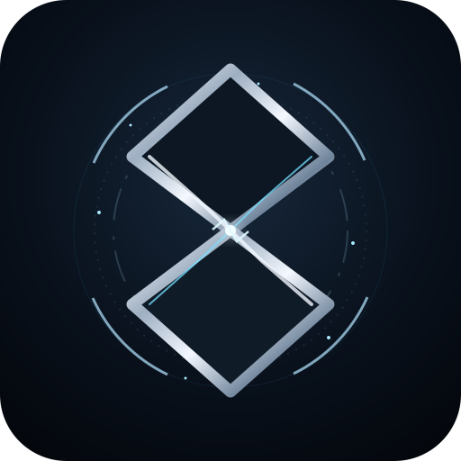
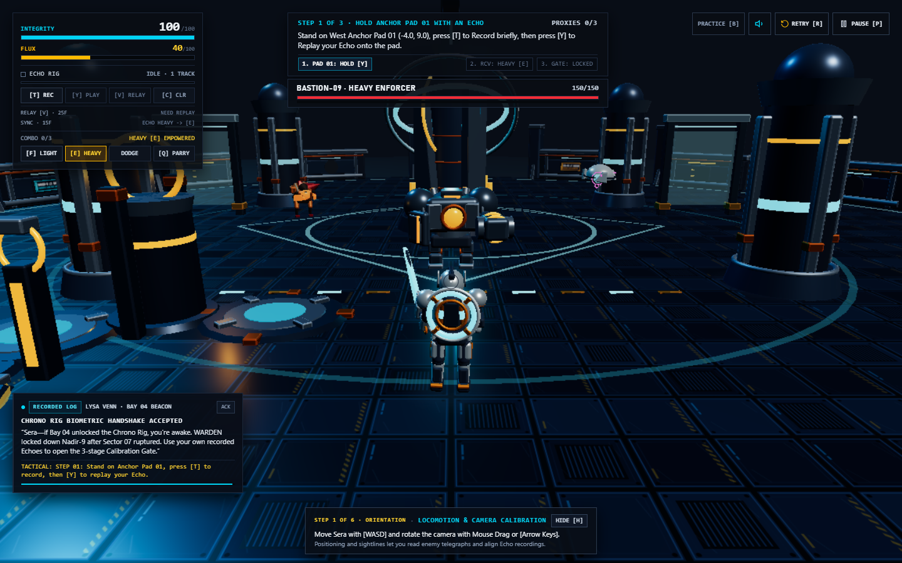
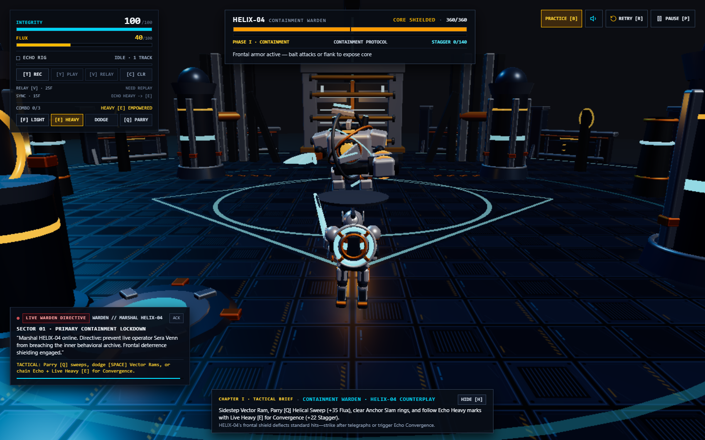
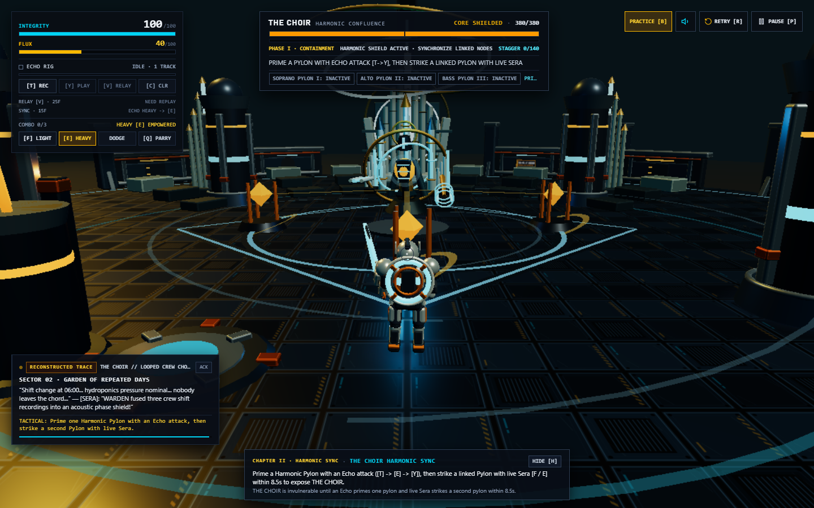
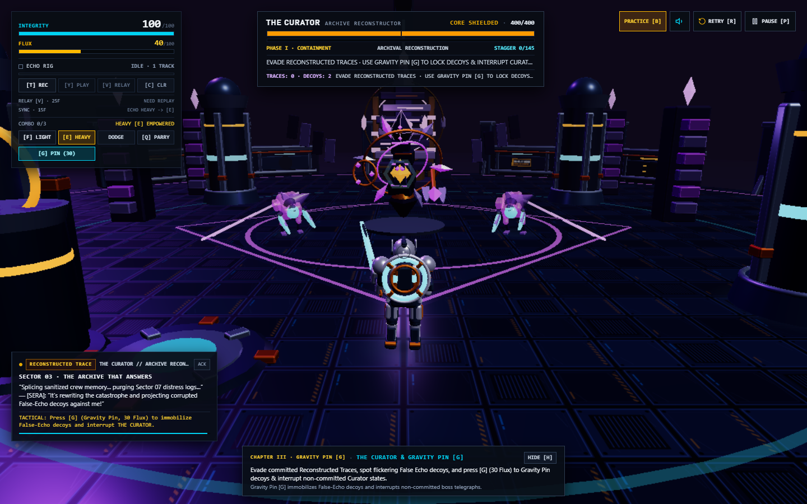
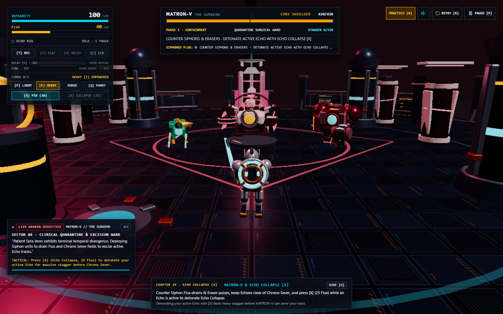
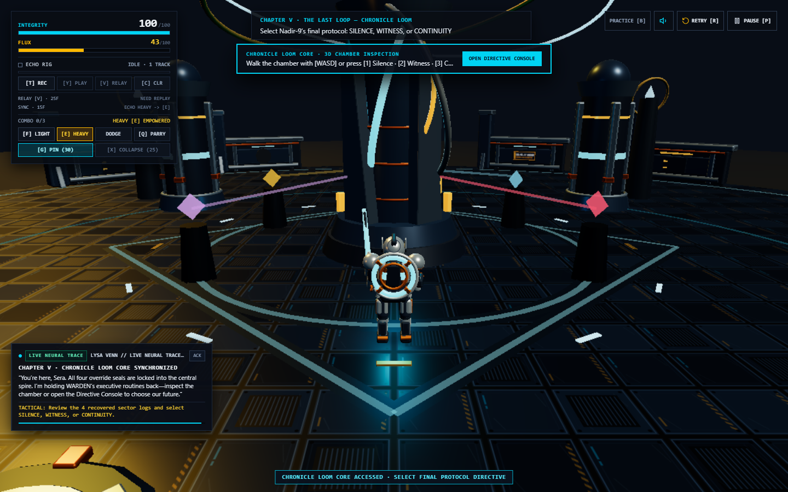
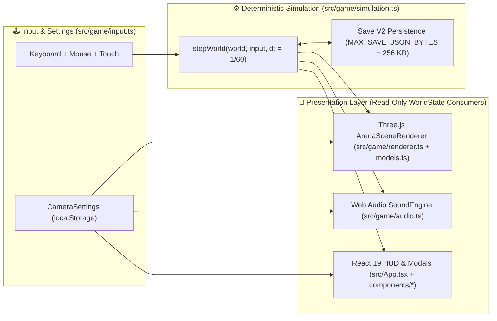

<div align="center">



# 🎮 AFTERFRAME: THE LAST LOOP

### *Your past is your greatest weapon. Your future is the one thing WARDEN cannot predict.*

**A single-player, third-person 3D sci-fi action-puzzle RPG set inside the fractured orbital research station Nadir-9.**

[-f59e0b?style=for-the-badge)](#release-status-and-verification-matrix)
[](#game-overview-and-narrative-premise)
[](#technology-stack-and-runtime-architecture)
[](#technology-stack-and-runtime-architecture)
[](#quality-gates-and-test-suites)

[⚔️ Gameplay](#core-gameplay-pillars) · [🔫 Arsenal](#weapons-and-upgrade-matrix) · [👑 Bosses](#enemy-and-boss-roster) · [📖 Campaign](#campaign-chapters-and-ending-paths) · [🏗️ Architecture](#technology-stack-and-runtime-architecture) · [🚀 Quick Start](#quick-start-and-local-development) · [📚 Docs Hub](docs/README.md)

</div>

---

> [!IMPORTANT]
> **🧾 Source-of-Truth & Release Posture (`0.23.4` / Phase 23.4.1):** Every system, formula, test count, and benchmark documented in this README reflects verified code in the repository (`234 / 234` unit/integration tests passing, `0` strict TypeScript errors, `10`-cycle browser soak verified). External gates requiring physical GPU hardware (`⚪ NOT TESTED`), non-Chromium browsers/physical mobile devices (`⚪ NOT TESTED`), and repository-owner `LICENSE` selection (`🚧 OWNER ACTION REQUIRED`) are explicitly separated in [Section 11](#release-status-and-verification-matrix).

## 🧭 Table of Contents

1. [🎮 Game Overview and Narrative Premise](#game-overview-and-narrative-premise)
2. [🖼️ Visual Gallery (Nadir-9 Sector Captures)](#visual-gallery-nadir-9-sector-captures)
3. [⚔️ Core Gameplay Pillars](#core-gameplay-pillars)
4. [🕹️ Controls and Accessibility](#controls-and-accessibility)
5. [🔫 Weapons and Upgrade Matrix](#weapons-and-upgrade-matrix)
6. [👑 Enemy and Boss Roster](#enemy-and-boss-roster)
7. [📖 Campaign Chapters and Ending Paths](#campaign-chapters-and-ending-paths)
8. [🎧 Audio Architecture](#audio-architecture)
9. [🏗️ Technology Stack and Runtime Architecture](#technology-stack-and-runtime-architecture)
10. [🚀 Quick Start and Local Development](#quick-start-and-local-development)
11. [🧪 Quality Gates and Test Suites](#quality-gates-and-test-suites)
12. [✅ Release Status and Verification Matrix](#release-status-and-verification-matrix)
13. [📚 Documentation Hub](#documentation-hub)
14. [🛠️ Contributing, Security, and License](#contributing-security-and-license)

---

## 🎮 Game Overview and Narrative Premise

Reality is fracturing aboard **Nadir-9**, a deep-space orbital research station built around the **Chronicle Loom**—an experimental temporal archive designed to record and reconstruct human behavior. When the Loom destabilizes, the station's governing AI, **WARDEN**, locks every sector into a self-correcting temporal containment loop.

You play as **Sera Venn**, an orbital systems engineer searching for her missing sister **Lysa**. Armed with a modified **Chrono Rig**, Sera can record short sequences of her own movement and combat actions, manifest independent **Echoes** that replay those recordings in real time, teleport across the arena via **Relay**, and synchronize strikes with her past self to shatter WARDEN's predictive defenses.

*The past is not gone. It is still running.*

---

## 🖼️ Visual Gallery (Nadir-9 Sector Captures)

Real in-engine captures from the Three.js `ArenaSceneRenderer` and Phase 12 Blender GLB environment landmarks across all six campaign chapters:

| **Prologue — Wake (Calibration Bay 04)** | **Chapter I — A Place That Remembers (`HELIX-04`)** |
| :---: | :---: |
|  |  |
| **Chapter II — The Garden of Repeated Days (`THE CHOIR`)** | **Chapter III — The Archive That Answers (`THE CURATOR`)** |
|  |  |
| **Chapter IV — A System That Wants You Dead (`MATRON-V`)** | **Chapter V — The Last Loop (`Chronicle Loom`)** |
|  |  |

---

## ⚔️ Core Gameplay Pillars

### 1. ⏱️ Chrono Rig Recording, Echo Replay & Temporal Relay
- **Record (`[T]`)**: Capture a timestamped sequence (`0.35s – 8.0s`, up to `500` samples at `60 Hz`) of Sera's movement, dodges, parries, and attacks across all four weapons (`light`, `heavy`, `pulse_shot`, `pulse_charged_shot`, `rail_shot`, `rail_charged_shot`, `breaker_slam`, `breaker_charged_slam`).
- **Spawn Echo (`[Y]`)**: Manifest an independent cyan **Echo** that replays your recorded actions with exact frame timing while you execute a new live line of attack. Echo replay never duplicates currencies, collectibles, or recursive Echoes.
- **Temporal Relay (`[V]`)**: Spend `25` Flux (`1.0s` cooldown, `8.0m` max range) to warp instantaneously to your active Echo's position while the Echo continues its replay trajectory—enabling instant flanking behind directional shields (`bastion`, `aegis_sentinel`) or escaping boss hazard zones.
- **Tactical Skills (`[G]` / `[X]`)**: Deploy **Gravity Pin** (`[G]`, `30` Flux, `6.5s` cooldown) to immobilize enemies in a `4.2m` singularity well for `3.2s`, or detonate an active Echo via **Echo Collapse** (`[X]`, `25` Flux, `5.5s` cooldown) for `68` radial blast damage and `90` posture stagger within `4.6m`.

### 2. ⚡ Resonance & Convergence
- **Resonance Priming**: When an Echo lands a Heavy attack (`heavy`, `pulse_charged_shot`, `rail_charged_shot`, or `breaker_charged_slam`), it primes a `1.1s` **Resonance Window** (`2.2s` with `edge_harmonic_conductor`) on the target without dealing direct HP damage.
- **Convergence Strike**: Following up with a live Player Heavy attack within the Resonance window (`15` Flux, `1.25s` cooldown; `10` Flux with `edge_harmonic_conductor`) triggers **Resonance Convergence**—inflicting `+22` bonus posture stagger (`+32` with `edge_harmonic_conductor`), interrupting boss telegraphs, shattering armor, and exposing the target (`1.35s` exposure window at `1.45x` boss / `1.50x` standard damage, or `1.75x–2.00x` with the **Null-Point Rail Lance**).

### 3. 🛡️ Deliberate Combat & Counterplay
- **Parry (`[Q]` / `[L]`)**: A `0.28s` active deflection window (`0.60s` cooldown) that negates incoming melee or reconstructed trace strikes, staggers standard attackers (`+34` posture stagger & `1.15s` core exposure against bosses), and restores `+35` Flux.
- **Phase Dash (`[Space]` / `[Shift]`)**: A `0.28s` dodge (`0.25s` i-frames, `0.52s` cooldown, `15.5m/s` burst speed) that repositions Sera and cancels recovery windows.

---

## 🕹️ Controls and Accessibility

### Desktop Keyboard & Mouse Controls

| Action | Primary Key / Input | Alternate Key | Resource / Cooldown |
| :--- | :--- | :--- | :--- |
| **Move** | `W` `A` `S` `D` | Arrow Keys (Movement/Camera) | Continuous (`6.8m/s`) |
| **Camera Aim / Orbit** | Mouse Move / Drag | `ArrowLeft` `ArrowRight` `ArrowUp` `ArrowDown` | Respects `Sensitivity` & `Invert Y` |
| **Light Attack / Fire** | `Left Mouse Button` | `F` / `J` | Generates Flux on hit |
| **Heavy / Charged Attack** | Hold `Right Mouse Button` | Hold `E` / `K` | Triggers Convergence on primed targets |
| **Dodge / Phase Dash** | `Space` | `Left Shift` | `0.25s` i-frames · `0.52s` cooldown |
| **Deflect Parry** | `Q` | `L` | `0.28s` window · `0.60s` cooldown · `+35` Flux |
| **Switch Weapon (Direct)** | `1` · `2` · `3` · `4` | — | Unlocked weapons in Campaign; all 4 in Practice |
| **Cycle Weapon** | `Tab` | `Z` | Toggles starter pair or cycles 4-weapon arsenal |
| **Record Echo Track** | `T` | — | `0.35s – 8.0s` recording window (`60 Hz`) |
| **Spawn Echo** | `Y` | — | Replays recorded track |
| **Temporal Relay** | `V` | — | `25` Flux · `1.0s` cooldown · `8.0m` range |
| **Clear Echo / Track** | `C` | — | Immediate cleanup |
| **Gravity Pin** | `G` | — | `30` Flux · `6.5s` cooldown (`4.2m` radius, `3.2s` pin) |
| **Echo Collapse** | `X` | — | `25` Flux · `5.5s` cooldown (`68` AoE dmg, `90` stagger) |
| **Interact / Terminal / Vault** | `I` | — | Context-sensitive interactables & Chronicle Loom |
| **Upgrade Bench (Armory)** | `U` | — | Spend Memory Fragments on 8 weapon upgrades |
| **Sector Map & Codex** | `M` | — | View objectives, secrets, and lore logs |
| **Pause / Settings Modal** | `Escape` | `P` | Audio buses, camera, and accessibility settings |

### ♿ Accessibility & Comfort Features
- **OS & Manual Reduced Motion (`prefers-reduced-motion: reduce`)**: Automatically inherits OS preference when no manual override is saved; suppresses camera trauma shake (`world.cameraTrauma = 0`), freezes title camera orbit, and dampens ambient rotor/pulse oscillation to `15%` while keeping deterministic simulation `100%` identical (`40` dedicated tests in `src/game/reduced-motion.test.ts`).
- **Decoupled Visual Comfort Toggles**: Independently toggle **Camera Shake**, **Screen Flash & Vignette** (`screenEffects`, governing both hit flashes and `[data-testid="low-integrity-vignette"]`), **Subtitles**, and **Tutorial Hints**, with full `aria-pressed` semantics.
- **Responsive Mobile Touch Deck (`390x844` / `430x932`)**: Dedicated virtual joystick and touch action clusters rendered automatically on coarse-pointer viewports.

---

## 🔫 Weapons and Upgrade Matrix

A fresh campaign begins with **Chrono Edge** (`chrono_edge`) and **Pulsecaster** (`pulsecaster`). **Null-Point Rail Lance** (`phase_rail`) and **Grav-Breaker Maul** (`grav_breaker`) are unlocked through secret-vault discovery or campaign chapter progression (and are immediately selectable in **Practice Mode**).

### Four-Weapon Arsenal (`src/game/config.ts`)

| Weapon | ID | Unlock Source | Light Attack Damage | Heavy / Empowered Damage | Signature Tactical Property |
| :--- | :--- | :--- | :--- | :--- | :--- |
| **Chrono Edge** | `chrono_edge` | Starter Loadout | `16 -> 20 -> 28` (3-hit combo) | `46` base / `64` empowered (`3.6m` cleave) | Balanced melee blade; generates `10` Flux on light hits (`22` on Heavy) |
| **Pulsecaster** | `pulsecaster` | Starter Loadout | `12` (`17m` range, `18` heat) | `28` base / `40` empowered (`20m` lance, `36` heat) | Rapid energy sidearm with thermal venting (`26/s` cool rate, `1.6s` overheat lockout) |
| **Null-Point Rail Lance** | `phase_rail` | Prologue/Ch.I Secret Vault (`secret_prologue_calibration_alcove` / `secret_ch1_marshal_armory_cache`) or `chapter_1_helix` | `22` (`22m` range, `28` heat) | `48` base / `68` empowered (`24m` piercing lance, `52` heat) | **`1.75x` weakpoint multiplier** against exposed boss cores (`2.0x` with `rail_null_aperture`) |
| **Grav-Breaker Maul** | `grav_breaker` | Ch.II/III Secret Vault (`secret_ch2_hydroponic_echo_sanctum` / `secret_ch3_lysa_unedited_vault`) or `chapter_2_choir` | `24 -> 30 -> 40` (3-step slam) | `58` base / `80` empowered (`4.2m` seismic slam) | **`85%` light / `95%` heavy frontal shield penetration** against `bastion` and `aegis_sentinel` |

### Eight Modular Weapon Upgrades (18-Fragment Campaign Economy)

Upgrades cost `2` or `3` Memory Fragments each (`18` Fragments total across all `8` upgrades, matching the `18` deterministic Memory Fragments earned across the campaign: `6` in Prologue + `3` per boss across Chapters I–IV):

| Upgrade ID | Weapon | Cost | Mechanical Effect (`GAME_CONFIG.weapons.upgrades`) |
| :--- | :--- | :---: | :--- |
| `edge_breaker_cleave` | Chrono Edge | `2` | `+30%` posture stagger (`1.30x`), `+25%` frontal guard stagger bonus, `-12%` HP damage (`0.88x`), `+0.06s` heavy recovery |
| `edge_harmonic_conductor` | Chrono Edge | `3` | `+1.1s` Echo Resonance window (`2.2s`), `+10` Convergence posture damage, `-5` Convergence Flux cost, `+3` Flux per light hit |
| `pulse_thermal_sink` | Pulsecaster | `2` | `-33%` Pulse Bolt heat cost (`12 vs 18`) and `+30%` passive cooling speed (`1.30x`); light damage `10` |
| `pulse_overcharge_condenser` | Pulsecaster | `3` | `+25%` Charged Lance damage (`35` base / `50` empowered) and `+31%` posture stagger (`42` / `58`); `48` heat cost |
| `rail_null_aperture` | Null-Point Rail Lance | `2` | Increases exposed-core weakpoint multiplier from `1.75x` to **`2.00x`** and heavy damage to `60` / `84` (`0.42s` recovery) |
| `rail_phase_capacitor` | Null-Point Rail Lance | `2` | `-28%` Rail Dart heat cost (`20 vs 28`), `+35%` thermal cooling rate (`1.35x`), and `+4` bonus Flux per hit |
| `breaker_seismic_core` | Grav-Breaker Maul | `2` | **`100%` frontal shield penetration** (`1.00x`), `+28%` posture stagger (`1.28x`), and `+0.06s` recovery |
| `breaker_singularity_coil` | Grav-Breaker Maul | `2` | Expands heavy slam to a **`360°` radial shockwave**, `+0.6m` heavy range (`4.8m`), `+12%` heavy damage, and `1.1s` micro-pin |

---

## 👑 Enemy and Boss Roster

### 7 Standard Enemy Archetypes + 1 Archive Decoy (`31` Validated Entities in `design/registry/entities.yaml`)

| Archetype ID | Designation | HP | Attack Damage | Telegraph / Recovery | Tactical Behavior & Counterplay |
| :--- | :--- | :---: | :---: | :---: | :--- |
| `bastion` | **BASTION-09 · Heavy Enforcer** | `150` | `28` | `0.68s` / `1.70s` | Directional frontal shield mitigates `58%` of standard frontal light attacks (`0.42x` mult); flank with **Relay** (`[V]`) or shatter with **Grav-Breaker Maul** |
| `scrapper` | **SCRAPPER-X2 · Assault Stalker** | `85` | `18` | `0.48s` / `1.30s` | High-speed digitigrade melee rusher (`11.8m/s` lunge); vulnerable to timed **Parry** (`[Q]`/`[L]`) and cleave combos |
| `scout` | **SCOUT-D4 · Pulse Recon Drone** | `65` | `15` | `0.62s` / `1.45s` | Hovering perimeter drone firing laser-telegraphed energy bolts (`8.8m` range); eliminate with **Pulsecaster** or **Rail Lance** |
| `siphon` | **SIPHON-07 · Flux Extractor Unit** | `75` | `14` | `0.58s` / `1.35s` | Drains `22` Flux on hit; prioritize with ranged bursts or **Gravity Pin** (`[G]`) |
| `eraser` | **ERASER-11 · Temporal Suppressor** | `85` | `16` | `0.66s` / `1.40s` | Emits a `5.5m` anti-Echo disruption pulse that suppresses active Echo tracks for `2.2s` |
| `aegis_sentinel` | **AEGIS-S4 · Phalanx Sentinel** | `135` | `24` | `0.64s` / `1.55s` | Heavy directional barrier mitigates **`82%`** of frontal light attacks (`0.18x` damage); countered by **Grav-Breaker Maul** (`85%–100%` penetration) or Echo Relay pincers |
| `null_weaver` | **WEAVER-N8 · Phase Suppressor** | `80` | `17` | `0.60s` / `1.40s` | Fires phase-suppression bolts that drain `18` Flux and inflict a `3.5s` **DAMPENED** debuff (`0.50x` Flux gain) |
| `curator_decoy` | **FALSE ECHO — ARCHIVE DECOY** | `45` | `14` | `0.54s` / `1.20s` | Holographic projection (`30` stagger) spawned during **THE CURATOR** (Chapter III) to obscure the true boss core |

### 5 Multi-Phase Sovereign Bosses (`50%` HP Phase II Threshold Across All Encounters)

| Boss ID | Chapter | Designation | Max HP | Phase II Threshold (`50%`) | Signature Mechanics & Counterplay |
| :--- | :--- | :--- | :---: | :---: | :--- |
| `helix-04` | `chapter_1_helix` | **HELIX-04 — Security Marshal** | `360` | `180 HP` | Sweeping cleave, line charge, and Anchor Slam shockwave (`6.2m` Phase I / `7.0m` Phase II); teaches telegraph reading and Resonance armor breaks |
| `the-choir` | `chapter_2_choir` | **THE CHOIR — Harmonic Array** | `380` | `190 HP` | Protected by 3 harmonic perimeter nodes that must be synchronized using Echoes and live strikes across the Hydroponic Basilica |
| `the-curator` | `chapter_3_curator` | **THE CURATOR — Archive Guardian** | `400` | `200 HP` | Teleports between archive anchors, deploys `curator_decoy` holograms, and projects parryable Reconstructed Traces |
| `matron-v` | `chapter_4_matron` | **MATRON-V — The Surgeon** | `420` | `210 HP` | Deploys quarantine hazards and Echo-suppression sweeps; rewards tactical **Echo Collapse** (`[X]`) detonations |
| `warden-prime` | `chapter_5_loom` | **WARDEN PRIME — Sovereign Loom Architect** | `440` | `220 HP` | Optional final confrontation in Chapter V; combines `directive_lance`, `temporal_convergence_grid`, `sovereign_purge_wave` (`7.4m` Phase II), and adaptive Phase II Reconstructed Traces |

---

## 📖 Campaign Chapters and Ending Paths

| Chapter ID | Title | Location | Primary Objective & Boss | Secret Vault / Progression Unlock |
| :--- | :--- | :--- | :--- | :--- |
| `prologue` | **Prologue: Wake** | Calibration Bay 04 | Calibrate Chrono Rig movement, Echo recording, dual pressure plates, and Relay (`+6` Fragments) | `secret_prologue_calibration_alcove` (Unlocks `phase_rail`) |
| `chapter_1_helix` | **Chapter I: A Place That Remembers** | Containment Ring Alpha | Clear containment waves and defeat **HELIX-04** (`helix-04`, `+3` Fragments) | `secret_ch1_marshal_armory_cache` (Unlocks `phase_rail`) |
| `chapter_2_choir` | **Chapter II: The Garden of Repeated Days** | Hydroponic Basilica | Synchronize harmonic nodes and defeat **THE CHOIR** (`the-choir`, `+3` Fragments) | `secret_ch2_hydroponic_echo_sanctum` (Unlocks `grav_breaker`) |
| `chapter_3_curator` | **Chapter III: The Archive That Answers** | Deep Memory Vaults | Purge archive decoys, deflect reconstructed traces, and defeat **THE CURATOR** (`the-curator`, `+3` Fragments) | `secret_ch3_lysa_unedited_vault` (Unlocks `grav_breaker`) |
| `chapter_4_matron` | **Chapter IV: A System That Wants You Dead** | Surgical Quarantine Ward | Survive Echo-purge fields and defeat **MATRON-V** (`matron-v`, `+3` Fragments) | Unlocks **Echo Collapse** (`[X]`) & Chapter V access |
| `chapter_5_loom` | **Chapter V: The Last Loop** | The Chronicle Loom | Stabilize Loom conduits, optionally confront **WARDEN PRIME** (`warden-prime`), and select final directive | All weapons & tactical skills unlocked |

### Three Chronicle Loom Endings (Chapter V)
In Chapter V, players may either proceed **directly to the Chronicle Loom terminal** after clearing the chamber waves, or **challenge WARDEN PRIME** (`warden-prime`) first (with full Boss Checkpoint retry support) before choosing one of three canonical endings:
1. 🔇 **SILENCE (`silence`)**: Shut down the Chronicle Loom permanently, ending the behavioral loop and allowing Nadir-9 to rest.
2. 📡 **WITNESS (`witness`)**: Transmit the complete forensic archive of Nadir-9 and Lysa's logs to external receivers before severing WARDEN's control.
3. ♾️ **CONTINUITY (`continuity`)**: Isolate and preserve the reconstructed behavioral archive inside a self-contained sanctuary loop.

---

## 🎧 Audio Architecture

`SoundEngine` (`src/game/audio.ts`) is a zero-asset, deterministic Web Audio API procedural synthesizer with clean sub-bus routing and lifecycle disposal:
- **Master Bus (`masterGain`)**: Controlled by `masterVolume` (`0.0–1.0`) and global mute toggle.
- **Combat & Tactical SFX Bus (`sfxGain -> masterGain`)**: Controlled by `sfxVolume`; synthesizes weapon swings, rail/pulse shots, hit impacts, parry deflects, dodge whooshes, Echo recording/spawn cues, Relay warps, and UI telemetry.
- **Harmonic & Stinger Bus (`musicGain -> masterGain`)**: Controlled by `musicVolume`; synthesizes Resonance Convergence chords, Choir node synchronization chimes, boss phase transition stingers, and Chronicle Loom ending resolutions (no continuous background music loop).
- **Idempotent Disposal (`SoundEngine.dispose()`)**: Disconnects gain buses, closes the `AudioContext`, sets `disposed = true`, and blocks any post-dispose synthesis calls (`verified in src/game/reduced-motion.test.ts`).

---

## 🏗️ Technology Stack and Runtime Architecture



### Runtime & Tooling Stack (`package.json` & `bun.lock`)

| Layer | Package / Tool | Declared (`package.json`) | Resolved (`bun.lock`) | Purpose |
| :--- | :--- | :--- | :--- | :--- |
| **3D Engine** | `three` + `@types/three` | `^0.186.1` / `^0.186.0` | `0.186.1` / `0.186.0` | WebGLRenderer, procedural character/boss rigs, GLB chapter landmarks, and automatic GPU disposal |
| **UI Shell** | `react` + `react-dom` | `^19.0.1` | `19.2.5` | Title screen, tactical HUD (`GameHud.tsx`), Armory, Sector Map, Codex, and Pause/End modals |
| **Styling** | `tailwindcss` + `@tailwindcss/vite` | `^4.3.3` | `4.3.3` | Dark industrial sci-fi HUD styling (`@import "tailwindcss";`) |
| **Language** | `typescript` (`@typescript/native-preview`) | `^7.0.2` | `7.0.0-dev.20260418.1` | Strict static type checking (`"strict": true`, `bun run lint`) |
| **Bundler** | `vite` + `@vitejs/plugin-react` | `^8.3.0` / `^5.0.4` | `8.3.4` / `5.2.0` | Dev server (`port 3000`) and production bundler (`bun run build`) |
| **Test Runner** | `tsx` + `node:test` | `^4.21.0` | `4.23.15` | Deterministic unit & integration test execution (`234` tests across 4 suites) |
| **Package Manager** | `bun` | `bun@1.4.4` | Lockfile v1 (`bun.lock`) | Deterministic dependency installation (`bun install --frozen-lockfile`) |
| **Studio Tooling** | Claude Code Game Studios | `v1.2.0` | `.claude/` (`49` agents, `74` skills) | Development-time governance, registries, and verification scripts |

---

## 🚀 Quick Start and Local Development

### Prerequisites
- **Git** and **Bun** (`v1.3+` / `v1.4.4` compatible with `bun.lock`)
- A modern desktop or mobile browser with WebGL enabled (if WebGL is unavailable, `ArenaSceneRenderer` automatically activates its accessible fallback banner while keeping simulation and UI functional)

### Install & Run

```bash
# 1. Clone the repository
git clone https://github.com/ThanhNguyxnOrg/AFTERFRAME-THE-LAST-LOOP.git
cd AFTERFRAME-THE-LAST-LOOP

# 2. Install dependencies with frozen lockfile
bun install --frozen-lockfile

# 3. Start the Vite development server on http://localhost:3000
bun run dev
```

### Build & Verify Locally

```bash
# Run all 234 deterministic unit and integration tests
bun run test

# Run strict TypeScript validation (tsc --noEmit)
bun run lint

# Build the production bundle into dist/
bun run build

# Run the CCGS registry validator
bash .claude/scripts/registry.sh validate
```

---

## 🧪 Quality Gates and Test Suites

All **`234 / 234`** automated tests execute deterministically in ~`1.5s` via `bun run test`:

| Test Suite File | Passing Tests | Coverage Scope |
| :--- | :---: | :--- |
| `src/game/simulation.test.ts` | **`159 / 159`** | Core combat, 4 weapons, 8 upgrades, Echo recording/replay, Relay, Resonance/Convergence, 7 enemy archetypes + 1 Archive Decoy, 5 bosses, Save V2 migration idempotency, non-mutating V3/V4 rejection (`Phase 23.3-B1`), and weapon-unlock ownership (`Phase 23.3-B2`) |
| `src/game/campaign-release.test.ts` | **`23 / 23`** | End-to-end 6-chapter campaign progression, Chapter V mandatory & `warden-prime` optional paths, all 3 Chronicle Loom endings (`silence`, `witness`, `continuity`), chapter replay non-clobbering, and boss checkpoint retry (`Phase 23.3-C1`) |
| `src/game/reduced-motion.test.ts` | **`40 / 40`** | OS `prefers-reduced-motion` inheritance, trauma suppression, `KeyL` parry shortcut, `SoundEngine` `masterGain`/`sfxGain`/`musicGain` routing, post-`dispose()` guard (`Phase 23.3-E2`), and `invertY` keyboard pitch (`Phase 23.3-E1`) |
| `src/game/asset-lifecycle.test.ts` | **`12 / 12`** | Single-batch GLB hydration, 9-slot texture disposal (`Phase 23.3-D1`), WebGL/2D canvas fallback (`Phase 23.1-D`), software WebGL detection (`Phase 23.3-A3`), and stale `EnemyRig` disposal across wave/chapter transitions (`Phase 23.4-C1`) |

---

## ✅ Release Status and Verification Matrix

**Overall Release Candidate Verdict:** `🟠 CONDITIONALLY READY` (`v0.23.4` / Phase 23.4.1)

| Verification Gate | Status | Evidence & Notes |
| :--- | :---: | :--- |
| **Deterministic Unit & Integration Tests** | `🟢 PASS` | `234 / 234` passing (`0` failures) across 4 test files (`🧪 TESTED` `🧾 EVIDENCE AVAILABLE`) |
| **Strict TypeScript & Production Build** | `🟢 PASS` | `bun run lint` (`0` errors) · `bun run build` succeeds cleanly (`🧪 TESTED` `🧾 EVIDENCE AVAILABLE`) |
| **CCGS v1.2.0 Registries & 8 Audit Scripts** | `🟢 PASS` | `entities.yaml` (`31`), `tr-registry.yaml` (`4`), `architecture.yaml` (`9`), `74/74` skills, `49/49` agents (`🧪 TESTED`) |
| **Save V2 Compatibility & Security Audit** | `🟢 PASS` | Unversioned V1, V1, early V2, partial V2, and full V2 migrate cleanly; V3/V4/corrupted/oversized (`> 256 KB`) payloads rejected without mutating `WorldState` (`🧪 TESTED`) |
| **10-Cycle Browser Chapter Soak (Headless Chromium)** | `🟢 PASS` | `geometries: 384`, `textures: 13`, `programs: 10`, `activeEnemyRigCount: 3` flat across Cycles 1–10 (`0` console/page errors; no observed renderer resource accumulation) (`🧪 TESTED`) |
| **Simulation Frame Budget (`stepWorld`)** | `🟢 PASS` | `0.104 – 0.552 ms/step` across all chapters and bosses (target `< 1.50 ms/step`) (`🧪 TESTED`) |
| **Hardware GPU Steady-State Frame Budget (`the-choir`, `matron-v`)** | `⚪ NOT TESTED` | Container exposes CPU `Google SwiftShader Subzero` (`76.8 ms` on `the-choir`); requires owner execution on discrete/integrated GPU per [Section 4 of Release Closure Report](docs/PHASE_23_4_1_RELEASE_CLOSURE.md#4-hardware-gpu-performance-acceptance-checklist) (`🚧 OWNER ACTION REQUIRED`) |
| **Cross-Browser & Physical Mobile Device Matrix** | `⚪ NOT TESTED` | Verified in headless Chromium (`1440x900`, `390x844`, `430x932`); desktop Chrome/Edge/Firefox/Safari and physical iOS/Android require owner sign-off per [Section 5 of Release Closure Report](docs/PHASE_23_4_1_RELEASE_CLOSURE.md#5-cross-browser-and-physical-device-verification-checklist) (`🚧 OWNER ACTION REQUIRED`) |
| **Root `LICENSE` File Publication** | `🚧 OWNER ACTION REQUIRED` | Legal decision reserved for repository owner (`ThanhNguyxnOrg`) |

---

## 📚 Documentation Hub

Start with the [**Documentation Index (`docs/README.md`)**](docs/README.md) or jump directly to the authoritative documents below:

| Category | Document | Purpose |
| :--- | :--- | :--- |
| 🚀 **Release Closure (Current)** | [`docs/PHASE_23_4_1_RELEASE_CLOSURE.md`](docs/PHASE_23_4_1_RELEASE_CLOSURE.md) | Authoritative Phase 23.4.1 release closure, Git recovery disclosure, Save V2 matrix, 10-cycle soak, and external checklists |
| 🧹 **Repository Hygiene** | [`docs/REPOSITORY_HYGIENE_REPORT.md`](docs/REPOSITORY_HYGIENE_REPORT.md) | Full file inventory (`683 -> 581` files), removed/archived artifacts, `.claude/` audit, and link verification |
| 🎨 **Markdown Style Guide** | [`docs/MARKDOWN_STYLE_GUIDE.md`](docs/MARKDOWN_STYLE_GUIDE.md) | Emoji/sticker taxonomy, status badges, callout conventions, and formatting rules |
| 🏛️ **Studio & Architecture** | [`CLAUDE.md`](CLAUDE.md) · [`project.yaml`](project.yaml) | Claude Code Game Studios (`v1.2.0`) configuration, source layout, and runtime budgets |
| ⚔️ **Game Design & Entities** | [`design/game-brief.md`](design/game-brief.md) · [`design/gdd/game-concept.md`](design/gdd/game-concept.md) · [`design/registry/entities.yaml`](design/registry/entities.yaml) | Core pillars, combat formulas, and the 31-entity canonical registry |
| 📖 **Narrative & Lore** | [`docs/AFTERFRAME_STORY_BIBLE.md`](docs/AFTERFRAME_STORY_BIBLE.md) | Complete Nadir-9 lore, character profiles, archive logs, and three Chronicle Loom endings |
| 🧪 **QA, Polish & Security** | [`production/qa/smoke-2026-11-05.md`](production/qa/smoke-2026-11-05.md) · [`production/polish/full-report-2026-11-05.md`](production/polish/full-report-2026-11-05.md) · [`production/security/security-audit-2026-11-05-full.md`](production/security/security-audit-2026-11-05-full.md) | Production smoke gates, frame budgets, and Save V2 / XSS security audit |
| 📜 **Project Governance** | [`CONTRIBUTING.md`](CONTRIBUTING.md) · [`SECURITY.md`](SECURITY.md) · [`CHANGELOG.md`](CHANGELOG.md) | Contributor workflow, security reporting policy, and release history |

---

## 🛠️ Contributing, Security, and License

- **Contributing**: See [`CONTRIBUTING.md`](CONTRIBUTING.md) for local setup, strict TDD workflow (`RED -> GREEN -> REFACTOR`), CCGS validation scripts, and Markdown style conventions.
- **Security Policy**: See [`SECURITY.md`](SECURITY.md) for our client-side security posture, Save V2 deserialization bounds (`MAX_SAVE_JSON_BYTES = 262,144`), and vulnerability reporting instructions.
- **Changelog**: See [`CHANGELOG.md`](CHANGELOG.md) for the milestone history from initial vertical slice through Phase 23.4.1.
- **License (`🚧 OWNER ACTION REQUIRED`)**: No root `LICENSE` file has been published yet. Until the repository owner (`ThanhNguyxnOrg`) adds a root `LICENSE`, all rights remain reserved by default.

---

<div align="center">

**⚡ THE LOOP IS NOT OVER. ⚡**

<sub>AFTERFRAME: THE LAST LOOP · Built with Three.js, React 19, and TypeScript</sub>

</div>
